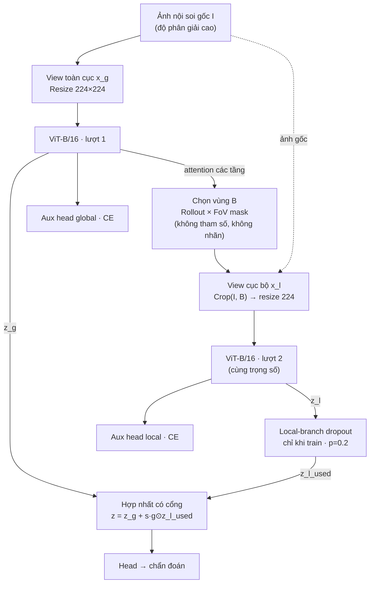

# Đặc tả mô hình: ViT "nhìn tổng thể rồi phóng to" (Glance → Focus)

> Tên mô hình là **tên tạm**. Tài liệu đóng gói kiến trúc, cách huấn luyện, bộ thực nghiệm và quy tắc chống rò rỉ nhãn cho tiểu luận Đề tài 7. Đây là thiết kế dự kiến, chưa có kết quả thực nghiệm.

---

## 1. Bối cảnh đề tài

| Mục | Nội dung |
|---|---|
| Đề tài | Kết hợp đặc trưng toàn cục và vùng ảnh cục bộ trong Vision Transformer cho phân loại ảnh nội soi tai |
| Mạng học sâu | ViT pretrained (ViT-B/16) |
| Câu hỏi nghiên cứu | Thông tin cục bộ có bổ sung cho biểu diễn toàn ảnh không? |
| Hướng thực hiện | Một nhánh toàn ảnh, một nhánh vùng cục bộ; vùng được chọn chỉ từ ảnh hoặc bằng mô hình học trên tập train |
| Thực nghiệm bắt buộc | ViT toàn ảnh; chỉ vùng cục bộ; nối đặc trưng; hợp nhất có cổng |
| Ràng buộc | Không chọn vùng bằng nhãn test |

**Đầu ra của mô hình:** nhãn chẩn đoán của từng ảnh (xác suất softmax, nhị phân hoặc đa lớp tùy thiết lập). Mô hình cũng trả ra hai đầu ra phụ để phân tích: hộp vùng được chọn và giá trị cổng g.

**Đầu ra của nghiên cứu:** câu trả lời có/không cho câu hỏi nghiên cứu, kèm bằng chứng gồm bảng ablation, kiểm định thống kê, phân tích tính bổ sung và hình minh họa.

---

## 2. Ý tưởng

Mô hình làm theo trình tự đọc ảnh của bác sĩ: nhìn toàn cảnh trước, sau đó tập trung vào vùng đáng ngờ. ViT xem ảnh toàn cục ở 224×224 và tự chỉ ra vùng quan trọng qua attention. Vùng đó được cắt từ **ảnh gốc độ phân giải cao** rồi đưa vào **chính ViT đó** thêm một lần nữa. Hai biểu diễn sau đó được hợp nhất bằng một cổng học được.

Hai nhánh dùng cùng một backbone ViT pretrained với trọng số dùng chung. Khác biệt duy nhất giữa hai nhánh là **vùng nhìn**. Nhờ vậy, nếu kết quả tăng thì có thể quy cho thông tin cục bộ, không bị lẫn với hiệu ứng của một backbone khác (ví dụ CNN).

---

## 3. Kiến trúc tổng quát



Dạng văn bản:

```text
Ảnh gốc I
 ├─(1) x_g = Resize(I, 224)
 │        └─ ViT-B/16 ──► z_g (CLS, 768) + attention các tầng
 ├─(2) Chọn vùng (không tham số, stop-gradient, không dùng nhãn):
 │        attention rollout → × FoV mask → làm mượt → hộp B
 ├─(3) x_l = Resize(Crop(I, B), 224)        ← cắt từ ảnh GỐC
 │        └─ ViT-B/16 (CÙNG trọng số) ──► z_l (CLS, 768)
 ├─(4) g = σ(MLP([LN(z_g) ; LN(z_l)]))       # [768]
 │     z_l_used = z_l × mask                  # chỉ train; p=0.2 đặt z_l_used=0
 │     z = z_g + s · g ⊙ z_l_used             # s học được, khởi tạo 0
 └─(5) logits = Head(z)
```

---

## 4. Thành phần chi tiết

### 4.1. Backbone

| Thuộc tính | Giá trị |
|---|---|
| Mô hình | ViT-B/16 pretrained (đề xuất dùng lại `vit_base_patch16_224.augreg2_in21k_ft_in1k` cho nhất quán với pipeline hiện có) |
| Đầu vào | 224×224, Normalize mean/std (0.5, 0.5, 0.5) theo cấu hình pretrained |
| Biểu diễn | Token CLS sau LayerNorm cuối, 768 chiều |
| Dùng chung | Toàn bộ trọng số dùng chung cho hai lượt forward |
| View embedding (tùy chọn) | Nếu bật `view_embed`, cộng e_global/e_local vào vector CLS đã pooling sau ViT; mặc định tắt (`False`) |

Khi bật, hai vector thêm 1,536 tham số; chúng được cộng vào biểu diễn sau encoder, không thay đổi đầu vào token hay attention của ViT. Cấu hình mặc định của trainer không bật view embedding.

Lưu ý khi cài đặt bằng `timm`: lớp attention mặc định dùng fused attention (`scaled_dot_product_attention`) nên không trả trọng số attention. Cần tắt `fused_attn` hoặc tự tính `softmax(QKᵀ/√d)` trong hook để lấy ma trận attention cho rollout.

### 4.2. Mô-đun chọn vùng (không tham số)

**Bước 1: Attention rollout** (Abnar & Zuidema, 2020; RAMS-Trans dùng cơ chế tương tự):

```text
Ā_l = mean_heads(A_l)                     # [197×197], l = 1..12
Â_l = normalize_rows(0.5·Ā_l + 0.5·I)     # cộng đường tắt residual
R   = Â_12 · Â_11 · … · Â_1
M   = R[CLS, 1:] → reshape 14×14          # bản đồ quan trọng, không phụ thuộc lớp
```

Biến thể so sánh: chỉ lấy attention CLS→patch ở tầng cuối, trung bình theo head.

**Bước 2: Lọc nhiễu**
- Nhân M với FoV mask (avg-pool về 14×14) để bỏ viền đen của ảnh nội soi. Dùng lại code FoV đã có: ngưỡng xám ≤ 0.05, flood-fill từ biên, closing 3×3, giữ thành phần hợp lệ lớn nhất, fallback toàn hợp lệ.
- Làm mượt M (Gaussian hoặc median 3×3) để vài token có attention bất thường ở nền không kéo lệch hộp. Hiện tượng token nhiễu này được mô tả trong *Vision Transformers Need Registers* (Darcet et al., 2024).

**Bước 3: Chọn hộp B.** Có hai cách, chọn một làm mặc định và giữ cách còn lại làm ablation:

| Cách | Quy tắc | Ưu / nhược |
|---|---|---|
| Cửa sổ cố định (đề xuất) | Quét cửa sổ vuông cạnh r·min(H, W), lấy vị trí có tổng M lớn nhất (dùng ảnh tích phân) | Độ phóng cố định = 1/r, dễ kiểm soát và phân tích |
| Ngưỡng theo trung bình (RAMS-Trans) | Giữ patch có M > α·mean(M), lấy thành phần liên thông lớn nhất, bao bằng hộp rồi pad thành vuông | Kích thước hộp thích nghi theo ảnh, khó phân tích hơn |

Hộp được kẹp trong biên ảnh. Mô-đun này **không có tham số** và **không truyền gradient** (stop-gradient).

### 4.3. View cục bộ

- Crop luôn cắt từ **ảnh gốc I**, không cắt từ x_g đã thu nhỏ.
- Cài đặt theo batch: DataLoader trả thêm một bản ảnh độ phân giải cao kích thước cố định (ví dụ 448 hoặc 512, hoặc độ phân giải gốc nếu đồng nhất). Phép crop + resize về 224 thực hiện trên GPU bằng `torchvision.ops.roi_align` hoặc `F.grid_sample` (nội suy bilinear như RAMS-Trans).
- Khi huấn luyện: jitter hộp (dịch ±10%, co giãn ±10%) để giảm lệch giữa crop train và crop test.
- Trước khi chạy: **thống kê độ phân giải ảnh gốc**. Nếu ảnh gốc nhỏ, crop rồi phóng to sẽ không thêm chi tiết mới; khi đó lợi ích chỉ còn là loại bỏ vùng thừa, và phải ghi rõ điều này.

### 4.4. Hợp nhất có cổng

```text
h = [LN(z_g) ; LN(z_l)]                        # 1536
g = σ( W₂ · GELU( W₁ · h ) )                   # 1536 → 256 → 768
z_l_used = z_l × mask                            # train: Bernoulli(1-p), p=0.2
z_fused = z_g + s · g ⊙ z_l_used                # s: scalar học được, khởi tạo 0
```

- Cổng theo từng kênh (768 giá trị) cho mỗi ảnh, nên mô hình học được *lấy bao nhiêu thông tin cục bộ cho từng ảnh*.
- s = 0 lúc khởi tạo nên E4 xuất phát đúng bằng ViT toàn ảnh. Ở các epoch đầu, khi attention còn nhiễu và vùng crop chưa tốt, nhánh cục bộ gần như chưa đóng góp. Sau đó s tăng dần và nhánh cục bộ mới tham gia. Cách này dùng lại module gate và s của FLG-ViT v2.
- Khi train, mỗi ảnh có xác suất mặc định 0.2 đặt vector đặc trưng cục bộ bằng 0 trước hợp nhất. Validation và inference dùng đầy đủ vector z_l.
- Với E3/concat, dùng `[z_g; z_l_used]`; với E4/gate, cổng cũng nhận z_l_used. Auxiliary head local vẫn nhận z_l gốc để nhánh cục bộ tiếp tục nhận tín hiệu CE độc lập.
- Local-branch dropout không thêm tham số.

### 4.5. Head

Head chính nhận đặc trưng hợp nhất: dropout và cosine classifier (τ=16 mặc định; có thể chọn Linear). E4/E3 có thêm hai auxiliary linear heads, một cho z_g và một cho z_l.

---

## 5. Huấn luyện và suy luận

### 5.1. Cách cài đặt chính: một khối, trực tuyến (1-a)

Mỗi lượt forward trong cả train và test:
1. Augmentation hình học (lật, xoay) áp lên ảnh gốc **trước**, rồi tạo x_g và bản ảnh độ phân giải cao từ cùng ảnh đã augment.
2. Forward ViT trên x_g → z_g và attention.
3. Rollout → hộp B (stop-gradient) → crop → x_l.
4. Forward cùng ViT trên x_l → z_l.
5. Nếu bật `view_embed`, cộng vector tương ứng sau pooling; khi train E3/E4, áp local-branch dropout trước hợp nhất và tính auxiliary CE trên z_g, z_l gốc. Validation/test/inference không áp dropout.

Vì hộp được tính trên chính ảnh đã augment, hai view luôn khớp nhau mà không cần đồng bộ thủ công.

| Mục | Thiết lập |
|---|---|
| Loss chính | Cross-entropy trên logits sau hợp nhất (class weights, label smoothing như pipeline hiện có) |
| Loss phụ E3/E4 | `L_total = L_fusion + λ·[CE(head_g(z_g)) + CE(head_l(z_l))]`; λ mặc định 0.3. Hai head phụ Linear buộc mỗi nhánh tự dự đoán được lớp; đặt λ=0 để tắt |
| Local-branch dropout E3/E4 | Mặc định p=0.2 trong train; z_l bị nhân với mask Bernoulli trước hợp nhất. Tắt trong validation/inference; auxiliary head vẫn dùng z_l gốc |
| View embedding (tùy chọn) | Mặc định tắt; nếu bật, e_global/e_local được cộng vào biểu diễn CLS sau pooling, không vào chuỗi token |
| Optimizer / lịch | Giữ như pipeline hiện có: AdamW, warmup tuyến tính rồi cosine, clip gradient 1.0 |
| Chọn checkpoint | Macro-F1 trên validation |
| Chi phí suy luận | 2 lượt forward ViT cho mỗi ảnh (khoảng 2× chi phí ViT toàn ảnh) cộng chi phí rollout |

### 5.2. Cách cài đặt thay thế: tách rời, crop tính trước (1-b)

1. Train E1 (ViT toàn ảnh), chọn checkpoint trên val.
2. Đóng băng E1 làm *selector*, chạy rollout cho mọi ảnh train/val/test, lưu hộp ra `boxes_{split}.json` kèm overlay để kiểm tra.
3. Train các mô hình còn lại trên crop đã lưu.

Dễ kiểm soát hơn nhưng khi suy luận tốn 3 lượt forward. Selector đã khớp với tập train nên crop của train có thể "sắc" hơn test. Cách giảm: jitter hộp khi train, hoặc cross-fitting k-fold (hộp của fold i do selector huấn luyện trên các fold còn lại tạo ra).

---

## 6. Bộ thực nghiệm

Mọi biến thể dùng cùng khung, cùng split, cùng lịch huấn luyện, cùng khởi tạo pretrained. Chúng chỉ khác ở bước hợp nhất hoặc cách lấy vùng.

### 6.1. Bốn thí nghiệm bắt buộc

| Mã | Thí nghiệm | Cài đặt |
|---|---|---|
| E1 | ViT toàn ảnh | logits = head(z_g); bỏ bước 2–3 |
| E2 | Chỉ vùng cục bộ | logits = head(z_l). Để ổn định, hộp lấy từ selector E1 đóng băng (cách 1-b) |
| E3 | Nối đặc trưng | logits = head(LN([z_g ; z_l_used])), Linear 1536 → C; auxiliary loss và local-branch dropout như mục 5.1 |
| **E4** | **Hợp nhất có cổng (đề xuất)** | Như mục 4.4; auxiliary loss và local-branch dropout như mục 5.1 |

### 6.2. Thí nghiệm đối chứng

| Mã | Đối chứng | Mục đích |
|---|---|---|
| C1 | E4 với crop ngẫu nhiên, cùng tỷ lệ r | Việc *chọn vùng bằng attention* có giá trị không? |
| C2 | E4 với crop cố định ở tâm FoV, cùng r | Có hơn một quy tắc đơn giản chỉ dựa vào ảnh không? |
| C3 | E4 với x_l là ảnh toàn cục, augmentation khác | Tách hiệu ứng "có thêm một lượt nhìn" (TTA/ensemble) khỏi thông tin cục bộ |
| C4 | Trung bình softmax của E1 và E2, không train thêm | Hợp nhất học được có hơn ensemble đơn thuần không? |
| R | Kiểu RAMS-Trans: train với CE(z_g) + λ·CE(z_l), suy luận chỉ dùng z_g | Tách "cục bộ là tín hiệu huấn luyện" khỏi "cục bộ là đặc trưng khi suy luận" |

### 6.3. Cách đọc kết quả

- E3/E4 > E1 có ý nghĩa thống kê, **và** > C1, C2, C3 → thông tin cục bộ (được chọn đúng) bổ sung cho biểu diễn toàn ảnh.
- E4 ≈ C3 → phần tăng chủ yếu do có hai lượt nhìn, không phải do vùng cục bộ.
- E4 ≈ C1 → chọn vùng bằng attention không hơn chọn ngẫu nhiên.
- R > E1 nhưng E4 > R → vùng cục bộ có ích cả khi làm tín hiệu huấn luyện lẫn khi làm đặc trưng suy luận.
- E3 so với E4 → trả lời trực tiếp câu hỏi "nối hay cổng".
- Kết quả "không bổ sung" vẫn là một kết luận hợp lệ, miễn là có bằng chứng.

---

## 7. Quy trình thực nghiệm

1. **Chia dữ liệu một lần**, lưu danh sách file, dùng chung cho mọi thí nghiệm. Ví dụ thiết lập Chile → Van: train/val tách từ Chile, test là toàn bộ Van.
2. **Chọn siêu tham số vùng trên val:** tỷ lệ r ∈ {0.4, 0.5, 0.6} (hoặc α nếu dùng ngưỡng), cách rollout, có/không FoV. Chốt bằng Macro-F1 trên val.
3. **Train tất cả biến thể** E1–E4, C1–C4, R với ít nhất 3 seed.
4. **Test một lần duy nhất ở cuối**, khi mọi cấu hình đã chốt.

### Thang đo và thống kê

- Accuracy, Precision, Recall (Sensitivity), Specificity, F1/Macro-F1, ROC-AUC; báo cáo mean ± std qua các seed.
- Kiểm định cặp trên cùng tập test: McNemar giữa E1 và E4; bootstrap khoảng tin cậy cho Macro-F1.
- Báo cáo chi phí: số tham số, FLOPs, latency của E1 và E4.

---

## 8. Phân tích trả lời câu hỏi nghiên cứu

1. **Bảng chéo 2×2 E1 × E2** (đúng/sai). Ô "E1 sai, E2 đúng" là bằng chứng trực tiếp về tính bổ sung.
2. **Phân bố giá trị cổng g** theo lớp và theo dự đoán đúng/sai.
3. **Giá trị s sau huấn luyện**: s gần 0 nghĩa là mô hình gần như không dùng nhánh cục bộ.
4. **Trực quan**: lưới gồm ảnh gốc, bản đồ rollout, hộp crop, nhãn thật, dự đoán E1/E4. Kèm confusion matrix, ROC.
5. **Độ nhạy theo r** và tỷ lệ hộp lệch ra ngoài FoV.
6. **Chất lượng crop khi đổi miền** (nếu train Chile, test Van): attention có còn rơi vào màng nhĩ không.

---

## 9. Checklist chống rò rỉ nhãn

Câu kiểm tra: *"Nếu có một ảnh bệnh nhân mới, chưa có chẩn đoán, quy trình chọn vùng có chạy y hệt như trên tập test không?"*

- [ ] Bản đồ chọn vùng là attention rollout, không phụ thuộc lớp. Nếu đổi sang Grad-CAM thì chỉ theo **lớp dự đoán**, không theo nhãn thật.
- [ ] Không có quy tắc chọn vùng khác nhau theo lớp.
- [ ] Không khoanh vùng thủ công trên ảnh test.
- [ ] Mọi trọng số (backbone, selector nếu dùng 1-b) chỉ học trên tập train.
- [ ] r, α, ngưỡng mask và cách rollout chọn trên val, không chọn trên test.
- [ ] Test chạy một lần sau khi đã chốt cấu hình; không quay lại sửa sau khi xem kết quả test.
- [ ] Tiểu luận có một đoạn mô tả rõ quy trình chọn vùng và khẳng định không dùng nhãn test.

---

## 10. Quan hệ với RAMS-Trans

Tham khảo: Y. Hu, X. Jin, Y. Zhang, H. Hong, J. Zhang, Y. He, H. Xue, "RAMS-Trans: Recurrent Attention Multi-scale Transformer for Fine-grained Image Recognition," *ACM MM*, 2021. arXiv:2107.08192.

**Kế thừa** (cần trích dẫn, không trình bày như ý tưởng mới):
- Dùng attention của chính ViT, nhân dồn qua các tầng, để định vị vùng quan trọng mà không cần nhãn vùng.
- Phóng to vùng bằng cách cắt từ ảnh gốc rồi nội suy, đưa lại vào cùng ViT với trọng số dùng chung.

**Khác biệt:**

| | RAMS-Trans | Mô hình này |
|---|---|---|
| Vai trò vùng cục bộ | Tín hiệu huấn luyện phụ; theo mô tả của bài, nhánh tỷ lệ 2 bị bỏ khi suy luận | Đặc trưng tham gia trực tiếp vào dự đoán khi suy luận |
| Hợp nhất | Không có, chỉ cộng loss hai tỷ lệ | Nối (E3) và cổng theo kênh với s khởi tạo 0 (E4) |
| Chọn vùng | Ngưỡng α·mean, thành phần liên thông lớn nhất | Cửa sổ cố định tỷ lệ r (mặc định) hoặc ngưỡng; nhân FoV mask cho ảnh nội soi |
| Bài toán | Phân loại chi tiết ảnh tự nhiên (CUB, Stanford Dogs, iNaturalist) | Ảnh nội soi tai, dataset nhỏ, có thể test chéo miền |
| Mục tiêu | Tăng accuracy | Kiểm chứng thông tin cục bộ có bổ sung không, bằng ablation và đối chứng |

Cần tự đọc lại mục 3 của bài RAMS-Trans trước khi viết phần so sánh: loss "guided", công thức rollout chính xác và quy tắc lấy hộp không được đặc tả đầy đủ trong bài.

Câu định vị gợi ý: *"Kế thừa cơ chế phóng to theo attention của RAMS-Trans, nghiên cứu này chuyển vùng cục bộ từ vai trò tín hiệu huấn luyện sang đặc trưng hợp nhất khi suy luận, so sánh phép nối với hợp nhất có cổng, và áp dụng cho ảnh nội soi tai."*

---

## 11. Phác thảo cài đặt (pseudo-code)

```python
class GlanceFocusViT(nn.Module):
    def __init__(self, num_classes, fusion="gate", crop_ratio=0.5,
                 use_fov=True, gate_hidden=256, drop_rate=0.1,
                 branch_drop=0.2, aux_weight=0.3, view_embed=False):
        self.vit = timm.create_model(
            "vit_base_patch16_224.augreg2_in21k_ft_in1k",
            pretrained=True, num_classes=0)          # trả CLS 768
        self.branch_drop = branch_drop
        self.aux_weight = aux_weight
        self.view_embed = view_embed                 # mặc định False
        if view_embed:
            self.view_g = nn.Parameter(torch.zeros(768))
            self.view_l = nn.Parameter(torch.zeros(768))
        # tắt fused attention để lấy được trọng số attention cho rollout
        self.fusion = fusion                          # global | local | concat | gate
        if fusion == "gate":
            self.ln_g, self.ln_l = nn.LayerNorm(768), nn.LayerNorm(768)
            self.gate = nn.Sequential(nn.Linear(1536, gate_hidden), nn.GELU(),
                                      nn.Linear(gate_hidden, 768), nn.Sigmoid())
            self.s = nn.Parameter(torch.zeros(1))
            in_dim = 768
        elif fusion == "concat":
            self.ln_cat = nn.LayerNorm(1536)
            in_dim = 1536
        else:
            in_dim = 768
        self.head = nn.Sequential(nn.Dropout(drop_rate), nn.Linear(in_dim, num_classes))
        if fusion in {"concat", "gate"}:
            self.aux_g = nn.Linear(768, num_classes)
            self.aux_l = nn.Linear(768, num_classes)

    def forward(self, x_g, x_hi, fov_mask=None):
        # x_g: [B,3,224,224]; x_hi: [B,3,H,W] ảnh độ phân giải cao cùng nguồn
        z_g, attn = self.encode_with_attention(x_g)          # lượt 1
        if self.view_embed:
            z_g = z_g + self.view_g                  # cộng sau pooling CLS
        if self.fusion == "global":
            return self.head(z_g)

        with torch.no_grad():                                # stop-gradient
            M = attention_rollout(attn)                      # [B,14,14]
            if fov_mask is not None:
                M = M * pool_to_grid(fov_mask, 14)
            boxes = select_window(M, x_hi.shape[-2:], self.crop_ratio)
            if self.training:
                boxes = jitter(boxes, shift=0.1, scale=0.1)
        x_l = roi_align(x_hi, boxes, output_size=224)        # crop từ ảnh gốc
        z_l = self.vit(x_l)                                  # lượt 2, cùng trọng số
        if self.view_embed:
            z_l = z_l + self.view_l

        if self.fusion == "local":
            z = z_l
        else:
            keep = (torch.rand(len(z_l), 1, device=z_l.device) >= self.branch_drop
                    if self.training else 1.0)
            z_l_used = z_l * keep
            if self.fusion == "concat":
                z = self.ln_cat(torch.cat([z_g, z_l_used], dim=-1))
            else:  # gate
                g = self.gate(torch.cat([self.ln_g(z_g), self.ln_l(z_l_used)], dim=-1))
                z = z_g + self.s * g * z_l_used
        aux_g = self.aux_g(z_g) if self.training and self.fusion in {"concat", "gate"} else None
        aux_l = self.aux_l(z_l) if self.training and self.fusion in {"concat", "gate"} else None
        return {"logits": self.head(z), "aux_g": aux_g, "aux_l": aux_l,
                "boxes": boxes, "gate": g if self.fusion == "gate" else None}

    def loss(self, output, target, criterion):
        loss = criterion(output["logits"], target)
        if output["aux_g"] is not None:
            loss += self.aux_weight * (criterion(output["aux_g"], target)
                                       + criterion(output["aux_l"], target))
        return loss
```

### Phần sửa so với code hiện tại

| Thành phần | Thay đổi |
|---|---|
| `TwoViewTransform` | Trả x_g (224) và x_hi (bản độ phân giải cao) từ cùng ảnh đã augment; trả thêm FoV mask nếu bật |
| Model | Một ViT, cờ `fusion ∈ {global, local, concat, gate}`; local-branch dropout và auxiliary heads cho E3/E4; view embedding sau pooling là tùy chọn; bỏ ConvNeXt và cross-attention |
| Mô-đun mới | `attention_rollout`, `select_window` (ảnh tích phân), `jitter`, crop bằng `roi_align` |
| Script mới (cho E2 / 1-b) | `select_regions.py`: nạp E1, sinh hộp và overlay, xuất `boxes_{split}.json` |
| `train.py` / `evaluate_test.py` | Thêm model selector mới, lưu `fusion`, `crop_ratio`, `use_fov` vào `model_config` của checkpoint |

---

## 12. Việc cần làm tiếp

1. Thống kê phân bố độ phân giải ảnh gốc của từng dataset để chọn r và kích thước x_hi.
2. Cài `attention_rollout` và kiểm tra overlay rollout × FoV trên vài chục ảnh train.
3. Cài model với bốn chế độ fusion; kiểm tra E4 với s = 0 cho đầu ra trùng E1 ở chế độ eval.
4. Chốt thiết lập nhãn (nhị phân Chile → Van hay đa lớp) cho tiểu luận.
5. Chạy E1 → chọn r trên val → chạy các biến thể còn lại với ít nhất 3 seed → test một lần.
6. Kiểm tra lại thông tin trích dẫn (RAMS-Trans, Abnar & Zuidema 2020, Darcet et al. 2024) trước khi đưa vào tiểu luận.
